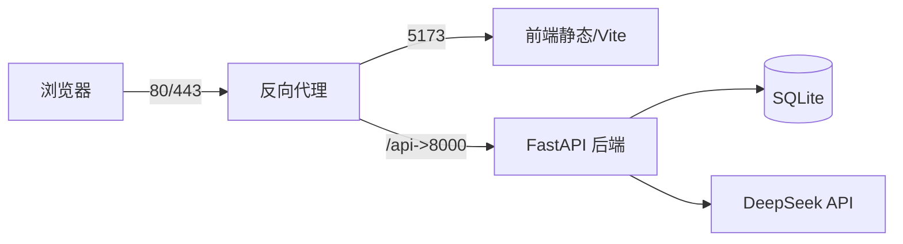

# 部署计划（Deployment Plan）

> 项目：表格数据 + LLM 融合的企业智能分析 Agent
> 编写：成员F · 版本 v1.0

## 1. 部署目标
在目标服务器（或演示主机）上稳定运行后端 + 前端，可被用户访问。

## 2. 部署架构

（图 1：部署拓扑）

## 3. 部署步骤
1. 配置 Python 3.13 + Node 22；
2. 后端：`uv pip install -r requirements.txt`，复制 `.env.example` 为 `.env` 填 Key；
3. 前端：`npm install && npm run build`，产物 `dist/`；
4. 用 `uvicorn` 启动后端（建议 `--workers` 或进程管理器）；
5. 用反向代理（Nginx/Caddy）转发：静态到前端、`/api` 到 8000；
6. 配置 CORS 允许前端来源。

## 4. 环境与配置项
- `.env`：LLM_PROVIDER/API_BASE/API_KEY/MODEL；
- 端口：8000（后端）、5173（开发前端）；
- 数据：`data/agent.db` + 上传文件（需持久化目录）。

## 5. Docker（可选说明）
国内部分 registry 已停运，Docker 部署需切换镜像源；仍提供 Dockerfile 编写说明（预留）。

## 6. 回滚与备份
- 备份 `data/` 目录；
- 保留上一版 `dist` 与依赖锁文件便于回滚。

## 7. 安全
- API Key 存 `.env` 不提交；
- 生产前端建议开启 HTTPS。

## 8. 时间与负责人
（填写计划上线时间、负责人。）
