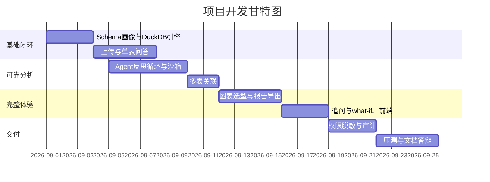

# 项目计划 / 项目管理计划

> 项目：表格数据 + LLM 融合的企业智能分析 Agent
> 编写：成员A · 版本 v1.0

## 1. 项目时间表（4 周）

| 周 | 阶段 | 主要任务 | 里程碑/输出 |
|:--:|:---|:---|:---|
| 第1周 | 基础闭环 | Schema 画像、DuckDB 引擎、上传接口、单表问答 | 基础问答可用 |
| 第2周 | 可靠分析 | Agent 反思循环、代码沙箱、多表关联 | 沙箱+反思+多表 demo |
| 第3周 | 完整体验 | 图表选型、报告导出、追问/what-if、前端 | 完整产品演示 |
| 第4周 | 交付 | 权限脱敏、审计、压测、文档、答辩 | 交付版 v1.0 |

## 2. 甘特图（Mermaid Gantt）

## 3. 资源分配

| 成员 | 岗位 | 主要负责 |
|:---|:---|:---|
| 成员A | 架构师 | 架构、需求规格、进度、总结 |
| 成员B | 后端 | FastAPI、数据层、接口 |
| 成员C | 算法 | Agent、Prompt、LLM、追问补全 |
| 成员D | 算法 | 沙箱、安全、多表、图表选型 |
| 成员E | 数据分析 | 前端、报告、评测集 |
| 成员F | 测试/部署 | 测试、部署、性能 |

## 4. 里程碑
- M1（第1周末）：单表问答闭环演示
- M2（第2周末）：沙箱+反思+多表 demo
- M3（第3周末）：图表/报告/追问完整演示
- M4（第4周末）：交付 v1.0 与答辩

## 5. 风险管理表

| 风险 | 概率 | 影响 | 应对 |
|:---|:---|:---|:---|
| LLM 生成代码错误率高 | 中 | 高 | Schema 注入+反思+降噪 |
| API 不稳定/超时 | 中 | 中 | Ollama 兜底+重试+离线预案 |
| 沙箱被绕过 | 低 | 高 | 白名单+禁网+限额+逃逸测试 |
| 百万行性能不足 | 中 | 中 | DuckDB 列式+预聚合+采样 |
| 多表关联键推断错 | 中 | 中 | 值域重叠+LLM 二次确认 |
| 4周工期紧张 | 高 | 高 | P0→P1 滚动交付+每周评审 |

## 6. 预算
开发与 API 费用：低（DeepSeek 计费按次），详见《项目提案》。
