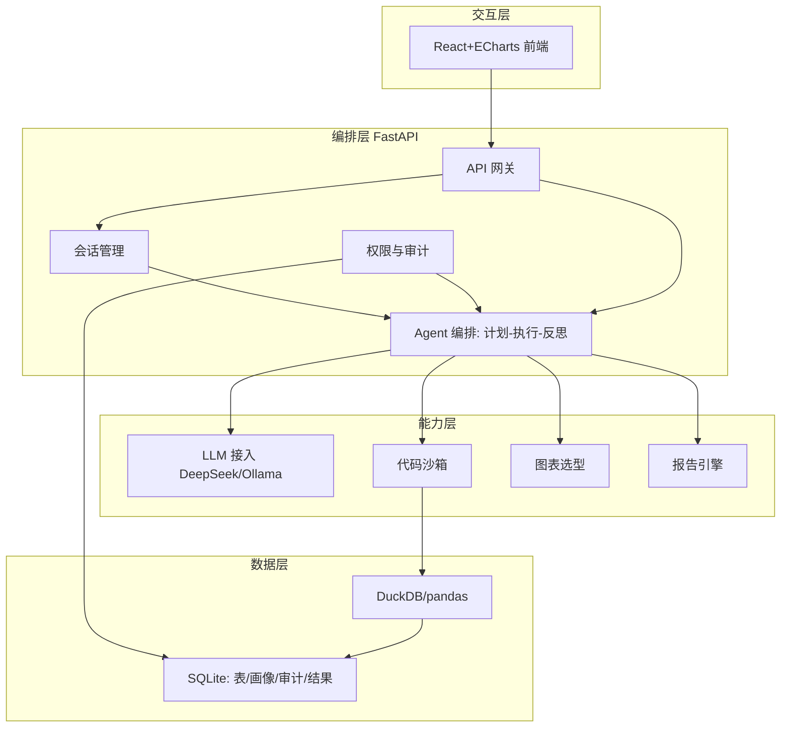

# 系统设计文档（System Design Document）

> 项目：表格数据 + LLM 融合的企业智能分析 Agent
> 编写：成员A / 成员C / 成员D · 版本 v1.0

## 1. 概述
本文档从纯技术角度描述系统架构、组件、接口与数据流。

## 2. 选型综述与对比

| 维度 | 选型 | 备选与方法 | 理由 |
|:---|:---|:---|:---|
| Agent 框架 | LangGraph（规划接入） | 自研循环（当前） | 有状态图、计划-执行-反思直观 |
| 表格引擎 | DuckDB | pandas + pyarrow | 百万行聚合毫秒级 |
| 大模型 | DeepSeek API | Qwen/Ollama 兜底 | 代码/中文强、便宜 |
| 沙箱 | 独立子进程 | 受限 exec | 隔离、超时强杀、防逃逸 |
| 后端 | FastAPI | Flask/Django | 异步、OpenAPI |
| 前端 | React + TS + ECharts | Vue3 | 生态 + 图表自动选型 |
| 报告 | python-docx/reportlab | WeasyPrint | 中文字体友好、纯 Python |
| 存储 | SQLite | PostgreSQL | 零运维演示 |

## 3. 总体架构

（图 1：系统总体架构）

## 4. 核心组建设计

### 4.1 Schema 画像（schema_profiler.py）
读表（DuckDB 直读 CSV，异常回退 pandas）→ 推断类型/示例值/空值率/基数 → 生成供 LLM 的文本画像；多表关联键由 `infer_join_keys` 按列名相同 + 值域重叠推断。

### 4.2 Agent 编排（agent.py）
状态 `AnalysisState`：question/profiles/table_paths/plan/code/exec_result/retry_count。
流程：plan → generate_code → sandbox.execute → 失败 fix_code 反思（≤`SANDBOX_MAX_RETRY`）→ auto_choose_chart → write_conclusion。

### 4.3 代码沙箱（sandbox.py / sandbox_worker.py）
- 独立子进程执行 worker；子进程内裁剪内建、禁用 `open`、白名单 import、限定 `__import__`；
- 主服务 `subprocess.run` 设 timeout 超时强杀；
- 用户代码与表路径以临时文件传递，避免命令行注入。

### 4.4 多表关联（joiner.py）
`infer_join_keys` 找共同列 → pandas merge 成宽表 → 缓存到 `.cache/` → 关联说明注入 Prompt。

### 4.5 图表选型（charting.py）
先必要性判断（≥2行、有类别列、类别基数≥2、有数值列），再按特征选图：趋势→折线、占比→饼、对比→柱；输出 ECharts option。

### 4.6 报告引擎（reporter.py）
把"多轮会话记录列表"渲染为 docx/python-docx 或 pdf/reportlab；每轮含问题、结论、数据表、图表类型 + matplotlib 自绘的真实图表图片、计划与代码（可复现）。

### 4.7 LLM 接入（llm.py）
`OpenAICompatibleProvider`（DeepSeek/Qwen/Ollama 换 base_url）；`complete_followup` 做极简追问补全；`MockProvider` 兜底。

## 5. 数据流（一次问答）
上传 → 画像 → 多表关联(如有) → 计划 → 代码 → 沙箱 → 反思 → 图表 → 结论 → 存 SQLite + 审计 → 返回前端。

## 6. 安全设计
沙箱隔离、白名单 import、超时强杀、审计留痕、方案中字段级权限与敏感列脱敏（接入规划）。

## 7. 可扩展性
LLM 可替换、沙箱可替换、报告格式可扩展、数据库可迁移 PostgreSQL。
